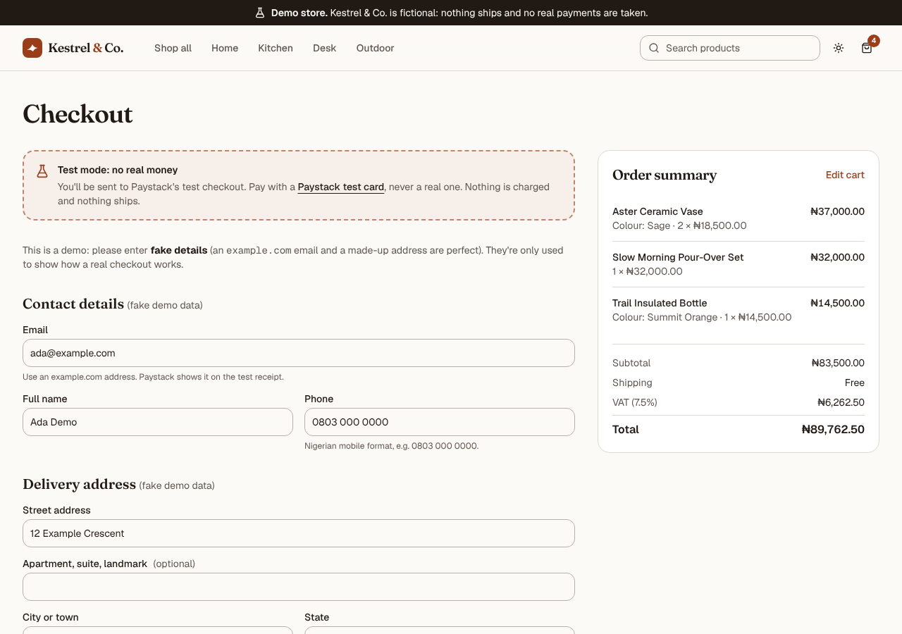
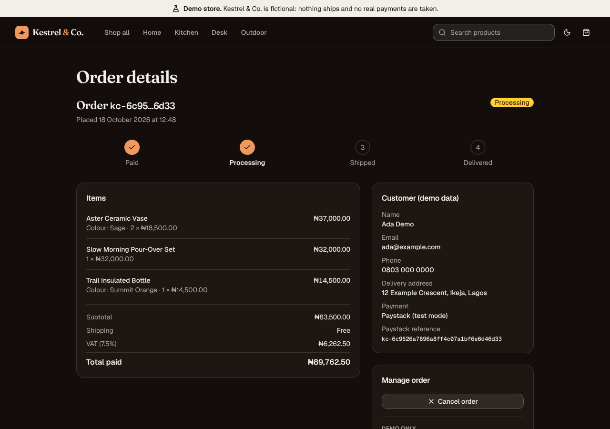

# ecommerce-store-demo

**Kestrel & Co.** is a portfolio demo of a modern online shop built by
[Emmanuel Kelvin](https://example.com). It's meant to look and behave like a real store, but the
brand, the products and the reviews are all made up, and payments run through
**Paystack test mode only**. Prices are in Nigerian naira (NGN).

> **Demo disclaimer.** This is not a real business. Nothing is for sale, nothing ships and no
> real payment is ever taken. Use only Paystack test cards. Contact addresses use `example.com`.

| Checkout                                                      | Order detail                                                         |
| ------------------------------------------------------------- | -------------------------------------------------------------------- |
|  |  |

## Features

- **Storefront.** Home page with a hero, featured products, category tiles and a trust strip.
  `/shop` has search, a category filter, a price range, sorting and "load more", all kept in the
  URL so any view can be shared or bookmarked. Each product has its own page with variants
  (colour or size), a quantity picker, related products and unique metadata.
- **Cart.** Saved to `localStorage` and validated with Zod on load, so tampered data can't break
  the app. It still works when storage is blocked. You get a cart drawer and a full `/cart` page
  with stock limits, a free-shipping progress bar, undo after removing an item and
  screen-reader announcements.
- **Pricing on the server's terms.** `priceCart` is a pure, tested function: line totals, free
  shipping from ₦75,000 (otherwise a flat ₦3,500) and 7.5% VAT, all in integer **kobo**
  (₦1 = 100 kobo). VAT is rounded half up to the nearest kobo using integer maths only. The
  cart only stores product ids and quantities. Prices always come from the catalogue.
- **Paystack checkout (test mode).** `/checkout` collects (fake) contact and delivery details,
  the server re-prices the cart from its own catalogue and starts a Paystack transaction in
  NGN. After payment, Paystack redirects to `/checkout/callback`, where the server verifies
  the transaction and the order is saved. `/orders` and `/orders/[id]` show the order history,
  with **Cancel order** and a demo-only **Advance status** button
  (paid → processing → shipped → delivered).
- **Firebase.** Anonymous auth only starts when a visitor needs it (checkout or orders), never
  on first page view. Orders live at `users/{uid}/orders/{paystackReference}`, protected by
  deny-by-default security rules with field validation and an explicit status lifecycle. The
  rules are covered by emulator tests.
- **Generated product art.** Every product image is an SVG illustration drawn in code. There
  are no photos and no hotlinked images.
- **Quality.** Semantic HTML, keyboard support, visible focus, WCAG AA contrast, light and dark
  themes with no flash on load, `prefers-reduced-motion` support and a mobile-first layout
  checked at 375, 768 and 1280 px. Axe-core audits are part of the browser QA script.

## Tech stack

| Area        | Tools                                                                  |
| ----------- | ---------------------------------------------------------------------- |
| Framework   | Next.js 16 (App Router, Cache Components), React 19, TypeScript strict |
| UI          | Tailwind CSS v4, shadcn/ui (Radix), lucide-react, sonner               |
| Data & auth | Firebase client SDK: Auth (anonymous) + Firestore                      |
| Payments    | Paystack REST API from the server, **test mode only**, NGN (kobo)      |
| Validation  | Zod, React Hook Form                                                   |
| Testing     | Vitest, Firebase rules-unit-testing + emulator, Playwright + axe-core  |
| Tooling     | ESLint, Prettier (with the Tailwind plugin), npm                       |

## Getting started

Requirements: **Node.js 20.9+** (22 recommended) and npm. The Firestore emulator used by
`npm run test:rules` and `npm run emulators` also needs **Java 11+**.

```bash
git clone https://github.com/apotato90/ecommerce-store-demo.git
cd ecommerce-store-demo
npm install
cp .env.example .env.local   # then fill in the values (see below)
npm run dev                  # http://localhost:3000
```

The storefront and cart work without any keys. Firebase is only needed for guest sessions and
order history. Paystack is only needed for checkout.

### 1. Create a Firebase project

1. In the [Firebase console](https://console.firebase.google.com/), create a project (Google
   Analytics is optional).
2. **Build → Authentication → Get started → Sign-in method**: enable **Anonymous**.
3. **Build → Firestore Database → Create database**: pick a location and start in
   **production mode**.
4. **Firestore → Rules**: paste the contents of [`firestore.rules`](./firestore.rules) and
   publish. The rules are deliberately not deployed from this repo.
5. **Project settings → General → Your apps**: add a **Web app** and copy its config values into
   the `NEXT_PUBLIC_FIREBASE_*` variables in `.env.local`.
6. **Authentication → Settings → Authorized domains**: add your deployment's domain.

### 2. Get Paystack test keys

1. Create a free [Paystack](https://dashboard.paystack.com/#/signup) account. You don't need to
   activate your business for test mode.
2. Make sure the dashboard is in **Test mode**.
3. **Settings → API Keys & Webhooks**: copy the **Test Secret Key** (`sk_test_…`) into
   `PAYSTACK_SECRET_KEY` and the **Test Public Key** (`pk_test_…`) into
   `NEXT_PUBLIC_PAYSTACK_PUBLIC_KEY` in `.env.local`. Never use live keys with this project:
   the server refuses any secret key that doesn't start with `sk_test_` and shows a "test mode
   only" error instead.
4. Set **`NEXT_PUBLIC_SITE_URL`** to the address you open the store on (for example
   `http://localhost:3000` locally, or your deployment's `https://` URL). The checkout sends
   Paystack a `callback_url` of `${NEXT_PUBLIC_SITE_URL}/checkout/callback`, so if this is
   wrong, Paystack sends shoppers back to the wrong place. `NEXT_PUBLIC_*` values are built
   into the app, so rebuild after changing it.

The secret key is only read by server code (`src/lib/paystack/server.ts`, which imports
`server-only`). The browser never talks to the Paystack API directly: it is redirected to
Paystack's hosted test checkout page. `NEXT_PUBLIC_PAYSTACK_PUBLIC_KEY` isn't needed for that
redirect flow; it's kept for reference and for a future inline (popup) checkout.

### Environment variables

| Variable                                   | Visibility      | Purpose                                                |
| ------------------------------------------ | --------------- | ------------------------------------------------------ |
| `NEXT_PUBLIC_FIREBASE_API_KEY`             | public          | Firebase web config                                    |
| `NEXT_PUBLIC_FIREBASE_AUTH_DOMAIN`         | public          | Firebase web config                                    |
| `NEXT_PUBLIC_FIREBASE_PROJECT_ID`          | public          | Firebase web config                                    |
| `NEXT_PUBLIC_FIREBASE_STORAGE_BUCKET`      | public          | Firebase web config                                    |
| `NEXT_PUBLIC_FIREBASE_MESSAGING_SENDER_ID` | public          | Firebase web config                                    |
| `NEXT_PUBLIC_FIREBASE_APP_ID`              | public          | Firebase web config                                    |
| `NEXT_PUBLIC_FIREBASE_USE_EMULATORS`       | public          | `true` to use the local Auth + Firestore emulators     |
| `NEXT_PUBLIC_SITE_URL`                     | public          | Site URL (metadata and the Paystack callback URL)      |
| `NEXT_PUBLIC_PORTFOLIO_URL`                | public          | Portfolio link in the footer                           |
| `NEXT_PUBLIC_PAYSTACK_PUBLIC_KEY`          | public          | Paystack test public key (`pk_test_…`)                 |
| `PAYSTACK_SECRET_KEY`                      | **server only** | Paystack test secret key. Never expose, log or commit. |

Firebase web config values are not secrets: they identify the project, and access is enforced
by `firestore.rules`. Only `.env.example` is committed. Every other `.env*` file is git-ignored.

### Running against the Firebase emulators

No Firebase project is needed for local development:

```bash
npm run emulators                                   # Auth :9099 + Firestore :8080 (project demo-kestrel)
NEXT_PUBLIC_FIREBASE_USE_EMULATORS=true npm run dev # in a second terminal
```

## How to try the checkout

1. Set up Firebase (or the emulators) and your Paystack **test** keys as above, then
   `npm run dev`.
2. Add a few products to the cart and click **Checkout**.
3. Fill in the form with **fake** details: an `example.com` email, a made-up name, a
   Nigerian-format mobile number such as `0803 000 0000`, and any address. Then click
   **Pay with Paystack (test mode)**.
4. On Paystack's test checkout page, pay with one of Paystack's **test cards** (see below).
   You can also close the page or cancel to see the "payment not completed" path.
5. Paystack sends you back to `/checkout/callback`. The server verifies the payment and the
   order is saved, then `/orders/[id]` opens. Try **Advance status** and **Cancel order**.
   Refreshing the callback page shows "already saved" instead of creating a duplicate.

### Paystack test cards

Only Paystack test cards work in test mode, and no real money moves. Paystack publishes the
current test cards (successful payment, PIN/OTP flows and declined cards) with their CVV, PIN
and OTP values on its official
[Test Payments](https://paystack.com/docs/payments/test-payments/) page. Use the details from
that page. They aren't copied here because Paystack's docs couldn't be reached to verify them
when this was written, and a wrong number is worse than a link. Never enter a real card.

### What the server checks

- `initializeCheckout` (a Server Action) receives **only** product ids, variants, quantities
  and the customer fields. It re-prices everything from `src/data/products.ts`, enforces stock
  and the 6-line cap, and creates the Paystack transaction. It sends the amount in kobo,
  currency `NGN`, an unguessable reference (`kc-` + 128 random bits) and the cart lines as
  metadata.
- `verifyCheckout` calls Paystack's verify endpoint and accepts the payment **only** if the
  status is `success`, the currency is `NGN` and the amount equals the total re-computed on the
  server from the metadata cart lines.

### Honest limitation (sandbox only)

After the server verifies a payment, the **visitor's browser** saves the order to Firestore
(signed in anonymously), using the Paystack reference as the document id so it can only be
saved once. The security rules validate every field and only allow the demo status changes.
Even so, this is **not tamper-proof**: a determined visitor could write a self-consistent fake
order into their own history. That's acceptable for a sandbox portfolio demo where no money
moves, but not for a real shop.

## Production notes

A real store would not let the browser write orders. Instead it would:

- Receive Paystack **webhooks** (`charge.success`) on a server endpoint and verify the
  `x-paystack-signature` header: an HMAC SHA-512 of the raw request body with your secret key.
  Reject anything that doesn't match.
- Verify the transaction server-side (status, currency, amount against the stored order), then
  write the order with the Firebase **Admin SDK** from the server, keyed by the reference so
  retries are idempotent.
- Make orders read-only for customers in the security rules and move status changes
  (fulfilment, cancellations and refunds) to trusted server code.

The webhook isn't built in this demo.

## Scripts

| Command                     | What it does                                                       |
| --------------------------- | ------------------------------------------------------------------ |
| `npm run dev`               | Start the dev server                                               |
| `npm run build`             | Production build                                                   |
| `npm start`                 | Serve the production build                                         |
| `npm run lint`              | ESLint                                                             |
| `npm run typecheck`         | Generate route types and run `tsc`                                 |
| `npm run format`            | Format with Prettier (`format:check` to verify)                    |
| `npm test`                  | Unit tests (pricing, catalogue, filters, cart, checkout, Paystack) |
| `npm run test:rules`        | Firestore security rules tests on the emulator (needs Java)        |
| `npm run emulators`         | Start the Auth + Firestore emulators                               |
| `npm run test:e2e`          | Browser QA + axe-core audit against a running server (see below)   |
| `npm run test:e2e:checkout` | Checkout/orders browser tests with emulators and a mock Paystack   |

`test:e2e` drives Chromium through the main flows (search, filters, URL state, add to cart,
persistence, undo, stock limits, mobile menu, blocked storage) and runs axe-core on every main
page at 375, 768 and 1280 px in both themes:

```bash
npx playwright install chromium   # first time only
npm run build && npm start        # in one terminal
npm run test:e2e                  # in another (BASE_URL defaults to http://localhost:3000)
```

`test:e2e:checkout` tests checkout and orders against the Firebase emulators and a **local
mock of Paystack** (`scripts/mock-paystack.mjs`), so it never calls the real Paystack API or
attempts a real payment. It covers form validation, success, abandoned, failed, tampered
amount, wrong currency, gateway errors with retry, duplicate callbacks, cancel and advance
status. It also runs axe-core on the new pages at 375, 768 and 1280 px in both themes:

```bash
NEXT_PUBLIC_FIREBASE_USE_EMULATORS=true NEXT_PUBLIC_SITE_URL=http://localhost:3100 npm run build
npm run test:e2e:checkout          # starts the emulators, the mock and `next start` on :3100
```

The app only accepts the `PAYSTACK_API_BASE_URL` override the tests use if it points at
`http://127.0.0.1` or `http://localhost`.

## Project structure

```
src/
  app/                 Routes: /, /shop, /shop/[slug], /cart, /checkout,
                       /checkout/callback, /orders, /orders/[id], not-found
  app/checkout/actions.ts  Server Actions: initializeCheckout, verifyCheckout
  components/
    cart/              Cart provider, drawer, line items, summary
    product/           ProductImage (SVG art), cards, rating, buy box
    layout/            Header, footer, demo banner, theme toggle, mobile menu
    shop/              URL-driven product browser
    checkout/          Checkout form, callback states, test-mode notice
    auth/ orders/      On-demand anonymous auth, order history and detail
    ui/                shadcn/ui components
  data/products.ts     Fictional catalogue (server-side source of truth)
  lib/
    shop/              Types, Zod schemas, priceCart, filters, catalogue helpers
    cart/              localStorage cart store
    checkout/          Zod schemas, server-side repricing, verification logic, references
    paystack/          Server-only Paystack REST client (test keys only)
    orders/            Status lifecycle helpers
    firebase/          Client init, auth helpers, order model
  proxy.ts             Real 404 status for unknown product slugs
firestore.rules        Security rules (paste into the Firebase console)
tests/rules/           Emulator tests for the rules
scripts/e2e.mjs        Playwright + axe-core browser QA
scripts/e2e-checkout.mjs   Checkout/orders browser tests (emulators + mock Paystack)
scripts/mock-paystack.mjs  Local mock of the Paystack endpoints, for tests only
```

## Notes

- **Order size.** Carts and orders are capped at 6 different products (up to 10 of each).
  Firestore rules can't loop, so each order line is checked one by one, and one rule evaluation
  is limited to 1000 expressions. The tests include a worst-case 6-line order to guard this
  limit.
- **Order statuses.** The rules allow exactly paid → processing → shipped → delivered, plus
  paid or processing → cancelled. Nothing else on an order can change after it's saved.
- **No indexing.** The site sets `noindex` so the demo doesn't show up next to real shops.

---

Demo store. No real orders. Paystack test mode. Built by Emmanuel Kelvin.
